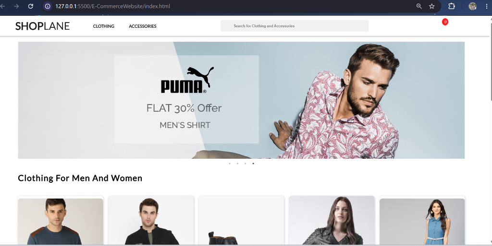
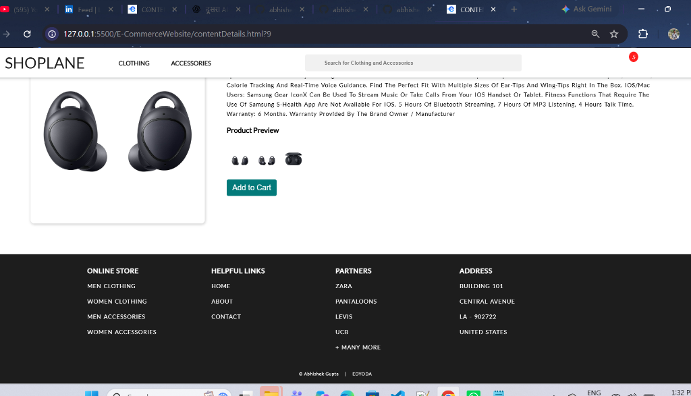

# E-CommerceWebsite

A mobile-responsive sample of an E-Commerce Website built with **HTML5, CSS3, JavaScript (ES6), and REST APIs**.

---

## 📸 Project Preview

### 🏠 Home Page

### 🛍️ Content Details Page

---

## 🌟 Key Features

- **Responsive Design**: Optimized for desktop, tablet, and mobile views.
- **Dynamic Product Rendering**: Fetches and renders product data dynamically from REST API.
- **Category Navigation**: Seamless jump navigation to Clothing and Accessories sections.
- **Product Details & Gallery**: Clickable image gallery preview on product page.
- **Interactive Shopping Cart**: Add to cart counter badge updated across all pages.
- **Order Placement**: Order summary and confirmation flow.

---

## 🛠️ Technologies Used

- **HTML5 & CSS3** (Flexbox & CSS Grid)
- **Vanilla JavaScript (ES6)**
- **jQuery & Slick Carousel** (Banner Slider)
- **FontAwesome** (Icons)
- **REST API** (MockAPI)

---

**&copy; Abhishek Gupta | EDYODA**
